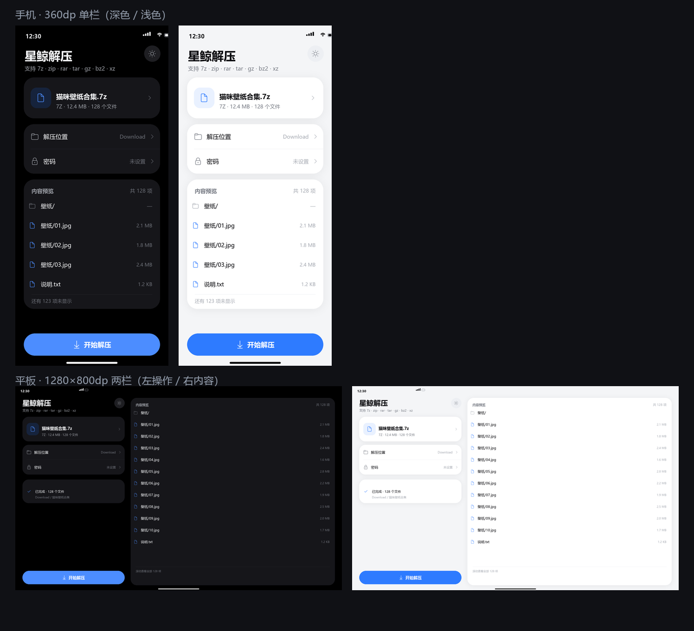
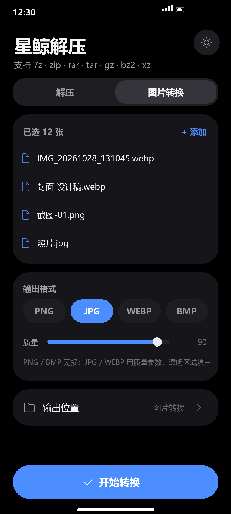
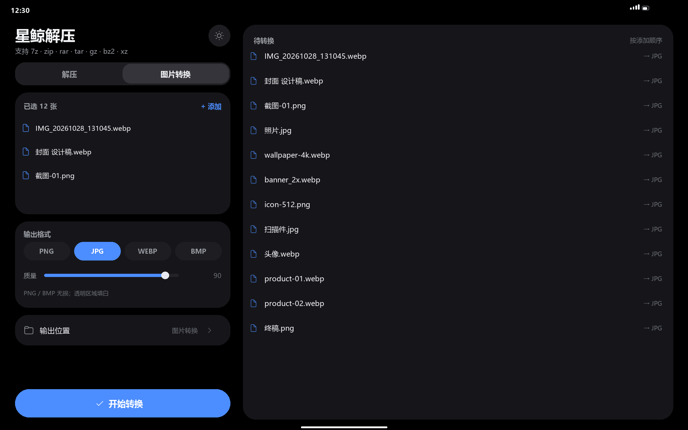

# 星鲸解压 (UnPack)

一个自用的 Android 解压 + 图片格式转换工具。界面按小米澎湃 OS 4 的设计语言手写（全程序化布局，不依赖 AppCompat / AndroidX），支持深色、浅色、跟随系统三种外观，手机单栏、平板两栏自适应。



## 功能

**解压**

- 7z / rar / zip / tar / tar.gz / tar.bz2 / tar.xz / gz / bz2 / xz
- 中文文件名自动纠编码：UTF-8 → GBK → ISO-8859-1 逐级回退
- 7z / rar 支持密码
- 先列表预览再解压，可取消，进度按字节
- 路径穿越（`../`）会被改写，不会写出目标目录

**图片转换**

- 输入：jpg / png / webp / bmp / gif / heic 等 `BitmapFactory` 支持的格式
- 输出：PNG / JPG / WEBP / BMP（BMP 编码器手写）
- JPG / WEBP 质量可调，透明区域填白，EXIF 方向自动摆正
- 批量：多选、全选、整个文件夹导入（可选含子文件夹）、长按删单条

**文件浏览**

- 应用内自建浏览器，替代系统的 DocumentsUI
- 面包屑路径、快捷入口、新建文件夹、记住上次目录
- 需要「所有文件访问」权限；拒绝则回落到系统选择器

## 截图

| 手机 · 深色 | 图片转换 · 手机 | 平板 · 两栏 |
| --- | --- | --- |
|  |  |  |

图标由文生图生成，再经 `tools/build_logo.py` 抠底、居中、转成自适应图标资源：

| 当前图标 | 生成候选 |
| --- | --- |
|  |  |

## 构建

环境：Windows + PowerShell 5.1+、JDK 17、Python 3、Android build-tools 34、platform-34。

```powershell
# 1. 拉依赖（JDK / build-tools / android.jar / 纯 Java 库）
python .\tools\download_deps.py

# 2. 编译 + 打包 + 签名
powershell -NoProfile -ExecutionPolicy Bypass -File .\build.ps1
```

`build.ps1` 做的事：

1. `aapt2 compile` / `link` 生成带资源的 base.apk
2. `javac -bootclasspath android.jar` 编译，再用 `d8 --min-api 26` 转 dex
3. 把 `classes.dex` 塞回 apk，`zipalign` 对齐，`apksigner` 签名
4. 输出 `out\UnPack.apk`

> 因为 `aapt2` / `dexdump` 处理含中文的路径会失败，脚本会先把工具链和工程镜像到
> `%TEMP%\unpack_build`（纯 ASCII）再构建。

**签名**：仓库不含签名密钥。`signing/unpack.keystore`（口令 `android`）只在本地保留，
否则任何人都能签发可覆盖安装的更新。首次无密钥时脚本会生成一把新的。

## 目录结构

```
project/
  AndroidManifest.xml
  res/                        主题、图标、矢量图标、字符串
  src/io/dafeiyu/unpack/
    MainActivity.java         壳：页签、解压页、主题切换
    ConvertPane.java          图片转换页
    FileBrowser.java          应用内文件浏览器
    Files.java                权限 / 目录列举
    Engine.java               解压核心（纯 Java，无 Android 依赖）
    ImageConv.java            图片编解码
    Sink / FileSink / TreeSink  输出目标抽象
    Theme / Ui / SlimBar      配色、控件工厂、进度条
build.ps1                     一键构建
merge_dex.py                  把 dex 合进 apk
tools/                        依赖下载、logo 生成
docs/                         截图
```

## 已知限制

- 解压的 RAR 路径**没有真实样本测试过**，只有 zip/7z/tar/gz/bz2/xz 验证过
- 图片转换只输出 PNG / JPG / WEBP / BMP；AVIF / TIFF / ICO 等系统没有编码器，未做
- 动图（GIF / 动态 WEBP）只取第一帧
- 使用 `MANAGE_EXTERNAL_STORAGE`，侧载可用，**上架 Google Play 会被拒**
- 解压前会把压缩包复制到缓存（7z/rar 需要随机访问），空间需约为包体积 + 解压后体积

## 版本

见 [CHANGELOG.md](CHANGELOG.md)。当前 v1.4.3。

## 说明

个人自用工具，代码仅供参考。第三方库许可见各自项目：Apache Commons Compress / IO / Lang3（Apache-2.0）、XZ for Java（Public Domain）、junrar（UnRAR License，仅解压用途）、SLF4J（MIT）。
